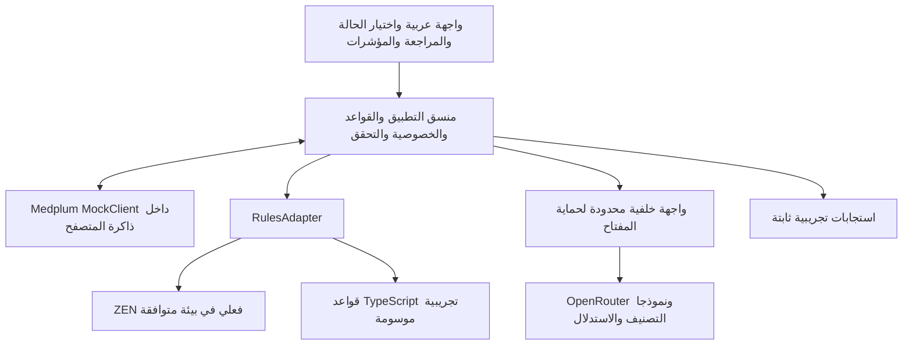

# المواصفات الفنية الموحدة لمحاكي منصة أجا

الإصدار 2.0 — النسخة الموحدة — 30 أكتوبر 2026  
اسم الملف المرجعي: `AJA_SIM_TECH.md`
البرومبت المصاحب: `AJA_SIM_BUILD_PROMPT.md` في المجلد نفسه.


**الأولوية:** السلوك الصحيح للسيناريوهات والمراجعة البشرية وحماية المفتاح أولًا؛ ثم وضوح العرض التفاعلي. المحاكي يعرض نمط تشغيل MVP المقترح، ولا يثبت تطابقًا إنتاجيًا أو امتثالًا حكوميًا. مدة الأسابيع الثمانية تخص المشروع المقترح؛ لا تُستنتج منها مدة تنفيذ أو ضمانات لهذا المحاكي.

## 1 الغرض وحدود المحاكي

بناء تطبيق تفاعلي عربي يوضح تشغيل النسخة الأولية المقترحة لدورة الإيرادات: اختيار مطالبة وهمية، وحفظها مع مهمة، وتنفيذ قواعد، ثم استدعاء الذكاء الاصطناعي عند الحاجة، وعرض الأدلة واعتماد الإنسان والنتائج ومؤشرات الأداء.

هذا تسليم عرض وتجربة، وليس نظامًا لمعالجة بيانات مرضى أو إرسال مطالبات حقيقية. بيانات المستشفى والتأمين والعقد والتعرفة والمستخدمين كلها اصطناعية. لا تمثل قواعد الأمثلة اشتراطات نفيس أو شركة تأمين حقيقية. لا تدريب نماذج ولا ربط إنتاجي ولا تحويل أموال.

النطاق: منشأة افتراضية واحدة، وشركة تأمين افتراضية واحدة، وعقد تجريبي واحد، ومطالبات عيادات خارجية بخمس حالات. لا يتطلب المحاكي خادم Medplum أو PostgreSQL أو Redis أو بطاقة رسومية. أسماء الموارد والحزم الإنجليزية أدناه مواصفات للمطور؛ الواجهة الأساسية عربية.

## 2 تعريف النجاح

- يستطيع المستخدم تجربة الحالات الخمس وإعادة ضبط كل حالة أو التجربة كاملة.
- تكون الموارد الفعلية داخل `MockClient` مصدر بيانات العرض؛ لا واجهة شكلية تعتمد مصفوفة مستقلة وتتجاهل ميدبلَم.
- تظهر رحلة المطالبة والقواعد والأدلة وقرار المراجع والتسوية التجريبية.
- يوجد وضع تجريبي ثابت يعمل دون مفتاح، ووضع نماذج فعلي عبر واجهة خلفية آمنة.
- تظهر هوية محرك القواعد ومزود النموذج الفعليان؛ لا تمرير نتيجة ثابتة على أنها استجابة AI حية.
- تحسب مؤشرات الأداء من أحداث التجربة، وتفصل الأرقام المحاكاة عن زمن الاستدعاء المقاس.

## 3 المعمارية المبسطة



المساران البديلان في المخطط خيارات تشغيل وليسا تنفيذًا مكررًا لكل طلب. لا اتصال للنموذج بمخزن الموارد؛ التطبيق وحده يحفظ النتيجة بعد التحقق منها. الواجهة والمنسق والموصلات في مستودع واحد. لا منظومة وكلاء ولا قاعدة متجهية ولا منصات مراقبة ثقيلة داخل المحاكي.

### الطبقات

| الطبقة | المكونات | مسؤوليتها |
|---|---|---|
| الواجهة | React وTypeScript ومكونات ميدبلَم عند ملاءمتها | عرض الحالة والدليل وقرار المراجع والمؤشرات |
| التطبيق | منسق المهام وRulesAdapter وAIGateway ومحاكي الربط | القواعد والتوجيه وتقليل البيانات والتحقق والحفظ |
| الذكاء | موصل تصنيف وموصل استدلال | نتائج مقيدة؛ لا صلاحية اعتماد أو إرسال |
| البيانات | MockClient من @medplum/mock | موارد FHIR وحالة المهمة والمخرجات المرتبطة |

## 4 اختيار بيئة البناء

المواصفات قابلة للتنفيذ على Sites أو Google AI Studio أو بيئة أخرى توفر بناء تطبيق ويب. لا تفترض أن المنصات متطابقة في تشغيل الخادم أو الأسرار أو الحزم الأصلية. على المنفذ اختبار القدرات وتوثيقها قبل اختيار التنفيذ.

- البناء الافتراضي React وTypeScript باستخدام أداة البناء التي تدعمها المنصة، دون فرض Vite على منصة لها قالب إلزامي.
- يمكن جعل التطبيق PWA إذا دعمت الاستضافة HTTPS وملفات الخدمة. فشل التثبيت لا يمنع استخدامه في المتصفح.
- التخزين داخل المتصفح، واستدعاءات AI عبر مسار خلفي محدود. إذا كانت المنصة واجهة ثابتة فقط، يسلم الوضع التجريبي، ويوثق متطلب ربط وسيط آمن قبل تفعيل AI الحي.
- وجود مشروع على GitHub لا يثبت توافق حزمته مع المتصفح أو بيئة Workers؛ لا تستورد حزم Node الأصلية مباشرة في الواجهة.

## 5 ميدبلَم داخل الذاكرة

استخدم `MockClient` من `@medplum/mock`، مع `@medplum/core` والتبعيات النظيرة المطلوبة للإصدار المختار. توثق الحزمة توافق واجهته مع `MedplumClient`، والكود يستخدم `MemoryRepository`. هذا مكوّن محاكاة واختبار، وليس خادم ميدبلَم إنتاجيًا مصغرًا بكل خصائصه. [1، 2]

متطلبات التنفيذ:

1. تثبيت إصدارات متوافقة وتسجيلها في ملف القفل، واختبار التجميع في المتصفح.
2. إنشاء نسخة واحدة من العميل لكل جلسة، وتمريرها لمزود سياق ميدبلَم إذا استُخدمت مكوناته.
3. بدء المخزن بلا أمثلة المكتبة الافتراضية إذا دعم الإصدار ذلك؛ تحميل الحالات الخمس فقط. لا تفترض وجود خيار أو توقيع دالة دون فحص الإصدار.
4. القراءة والإنشاء والتحديث والبحث تتم عبر واجهة العميل. لا كتابة إلى خصائص داخلية غير موثقة.
5. اختبار موارد Patient وClaim وTask وDocumentReference وغيرها المطلوبة. إذا غابت عملية عن المحاكاة، يوثق القصور ويقيد المسار؛ لا ادعاء توافق FHIR كامل.
6. الافتراضي ذاكرة الجلسة، وتحديث الصفحة يعيد البيانات. يظهر تنبيه بذلك.
7. أزرار تصدير واستيراد JSON لحالة التجربة، دون أسرار. الحفظ المحلي الاختياري للبيانات الاصطناعية فقط، مع زر مسح وإصدار مخطط والتحقق من المدخل.
8. لا ادعاء ضمان المعاملات أو الصلاحيات أو التعافي الإنتاجي بناء على نجاح MockClient. اختبارات الخادم الفعلي مستقلة لاحقًا.

## 6 القواعد ومحرك ZEN

`ZEN Engine` محرك قواعد حتمي، وموضعه وحدة القواعد قبل استدعاء النماذج. ليس نموذجًا لغويًا. يدعم المشروع الرسمي تشغيل المحرك من بيئات منها Node؛ يلزم إثبات توافق النسخة مع بيئة النشر المختارة. [3، 4]

واجهة ثابتة للمشروع:

```ts
type RuleResult = {
  engine: 'zen' | 'typescript-demo';
  ruleVersion: string;
  passed: boolean;
  violations: Array<{ruleId: string; field: string; severity: 'block'|'review'; messageAr: string}>;
  route: 'human-review'|'needs-correction'|'ai-evidence'|'denial-review'|'reconciliation';
};
interface RulesAdapter { evaluate(input: RuleInput): Promise<RuleResult> }
```

- الخيار المفضل: ZEN فعلي، داخل خادم متوافق أو عبر واجهة خدمة محدودة. نسخة متصفح أو WASM لا تعتمد إلا بعد التحقق من مصدرها وترخيصها ونجاح تجميعها وتشغيلها.
- عند عدم توفر بيئة متوافقة: تنفيذ مجموعة القواعد نفسها بدوال TypeScript واضحة ومختبرة، مع شارة «قواعد تجريبية بديلة عن زِن» وتوثيق الفرق. هذا وضع محاكاة مسموح، ولا يحقق بند «ZEN فعلي» في تقرير التسليم.
- تخزن القواعد بمصدر مؤرخ. إن اختلفت صيغة ملفات ZEN عن البديل، توفر اختبارات أمثلة مشتركة تثبت تطابق نتائج الحالات الخمس.
- لا تنشأ قاعدة تلقائيًا من تكرار تعديل بشري. يدعم المحاكي اقتراح قاعدة واختبارها واعتمادها محليًا وفق القسم 6.1؛ لا نشر إنتاجي أو تعلم تلقائي للنموذج.

قواعد الأمثلة: وجود رقم عضو تأميني؛ وجود تاريخ خدمة؛ مبالغ صحيحة غير سالبة؛ معرف مطالبة غير مكرر؛ تعرفة من العقد التجريبي؛ وجود مستند داعم للخدمة المختارة؛ منع الإرسال قبل اعتماد المراجع؛ منع الإغلاق المالي قبل اكتمال التسوية التجريبية. جميعها قواعد المشروع الوهمي وليست مواصفة نفيس.

### 6.1 تجربة «نتعلم معًا»: اقتراح قاعدة تحت المراجعة

ميزة إلزامية مبسطة مرتبطة بالحالة S4، مستوحاة من ملف المقارنة:

1. بعد مراجعة سبب الرفض، يظهر «اقتراح قاعدة تجريبية: التحقق من إرفاق المستند الداعم للخدمة DEMO-SVC-03 قبل الإرسال».
2. لا تظهر عبارة «تكرر خمس مرات» إلا إذا وجد خمس أحداث فريدة فعلية في سجل الجلسة. لا تضف تاريخًا تشغيليًا مختلقًا.
3. ينشأ `RuleProposal` محلي: المعرف، نص الشرط، سبب الاقتراح، مراجع الأدلة، النطاق، الإصدار، وحالة `draft/tested/approved/active/retired`. هذا كيان تطبيق وليس نوع FHIR جديدًا.
4. تعرض معاينة الفرق، ويشغّل زر «اختبار القاعدة» ثلاثة أمثلة: الخدمة المعنية بلا مرفق → حجب؛ الخدمة نفسها بمرفق → اجتياز؛ خدمة أخرى → لا تأثر.
5. بعد نجاح الاختبار يوافق المستخدم صراحة ثم يفعّلها للجلسة؛ تعرض «قاعدة تجريبية نشطة» واسم المحرك الحقيقي. لا يقبل التطبيق شيفرة أو تعبيرًا حرًا مولدًا من LLM؛ يستخدم قالب شرط محدودًا ومتحققًا منه.
6. يعاد اختبار الحالات الخمس. لا تعدّل القاعدة التاريخ ولا اعتماد مطالبة سابقة بصمت؛ التشغيل الجديد يسجل الإصدار الجديد، وأي إعادة فحص تبطل الاعتماد المتأثر.
7. تتوفر إعادة الإصدار السابق، والتصدير، وإعادة الضبط. لا تسمى القاعدة دائمة إلا بمعنى حفظ محلي اختياري معلن؛ ليست منشورة إلى نظام AJA.

لإظهار التحسن، قاعدة فحص وجود التقرير في المخزن تختلف عن قاعدة دخوله في حزمة الإرسال. الحالة S4 تبدأ برد رفض محفوظ من إرسال تاريخي اصطناعي؛ بعد تفعيل القاعدة الجديدة يحجب التشغيل الجديد الحزمة التي تُسقط التقرير، ولا يعاد تصنيع رفض أولي يخالف القاعدة.

## 7 أدوار النماذج وأوضاع التشغيل

### وضع العرض الثابت

يعمل بلا شبكة أو مفاتيح بعد تحميل التطبيق. يستخدم نتائج JSON ثابتة مصرحًا بأنها محاكاة، وتبقى قواعد الأعمال والحسابات تفاعلية فعلًا. لا تعرض أزمنة انتظار مصطنعة باعتبارها أداءً مقاسًا لنموذج.

### وضع AI الفعلي

- يستدعي التطبيق وسيطًا خلفيًا، وهو يستدعي OpenRouter.
- نموذج التصنيف بديل تجريبي لدور Laya: يعيد نوع الملاحظة وأولوية المراجعة وسببًا قصيرًا. لا يسمى Laya إذا لم يكن هو النموذج الفعلي، ولا تعرض درجته كاحتمال رفض تأميني معاير.
- نموذج الاستدلال Qwen مرشح مفضل إن توفر معرف مناسب وقت التنفيذ؛ وإلا بديل قابل للإعداد مع عرض اسمه الحقيقي.
- تضبط معرفات النموذجين في الخادم؛ تتحقق من وجودها وصلاحياتها ودعمها للمخرجات المهيكلة قبل الاختبار. لا تخترع معرف نموذج أو تفترض توفر Laya عبر OpenRouter.
- يمكن استعمال النموذج نفسه للدورين بتعليمات مختلفة لتبسيط التجربة، مع الإفصاح عن ذلك.
- التصنيف في وضع ظل؛ لا يحجب المطالبة أو يصبح شرطًا لازمًا لاستدعاء الاستدلال. المنسق يحدد الاستدعاء من المهمة والقواعد.
- الحالات 1 و2 و5 لا تحتاج استدلالًا افتراضيًا؛ الحالتان 3 و4 تستخدمانه عند طلب التحليل. التصنيف التجريبي اختياري للنصوص في الحالتين 3 و4.
- لا موافقة آلية ولا تشخيص جديد ولا تعرفة أو مبلغ مولد من النموذج.

## 8 المفاتيح والواجهة الخلفية

إعدادات خادم فقط: `OPENROUTER_API_KEY` و`AI_CLASSIFIER_MODEL` و`AI_REASONER_MODEL`. يزود المستخدم المفتاح لاحقًا بآلية الأسرار المتاحة. لا يوضع في ملفات الواجهة أو متغيرات البناء العامة أو localStorage أو مستودع المصدر أو التقارير. لا تطلب لصقه في حقل ظاهر داخل التطبيق.

واجهة المشروع المقترحة، وليست API خاصة بميدبلَم:

```text
GET  /api/sim/capabilities
POST /api/sim/ai/classify
POST /api/sim/ai/reason
POST /api/sim/rules/evaluate     # فقط إذا احتاج ZEN تشغيلًا خلفيًا
```

`capabilities` يعيد وضع البيانات ومحرك القواعد وأسماء النموذجين وجاهزية الاتصال دون أسرار. لا يعمل الوسيط كوكيل مفتوح: يقبل نوع مهمة معروفًا ونصًا محدودًا، ويمنع تمرير URL أو تعليمات نظام أو نموذج عشوائي من المتصفح. يقيد الوصول بجلسة أو حماية المنصة المناسبة، وحدود طلبات وحجم وميزانية؛ رابط عام مع مفتاح خادم بلا حماية غير مقبول.

الاستدعاء الخارجي وفق OpenRouter: `POST https://openrouter.ai/api/v1/chat/completions` من الخادم فقط. يستخدم مخطط JSON مع النماذج الداعمة، ويطبق تحققًا محليًا دائمًا. لا يعد دعم JSON ضمانًا لصحة الاستنتاج. [5، 6]

حدود ابتدائية قابلة للتعديل: 12 ألف حرف للنص، 1500 رمز للمخرج، مهلة 45 ثانية، محاولة إعادة واحدة للأخطاء المؤقتة فقط مع تأخير، وعدم إعادة أخطاء المصادقة أو المخطط تلقائيًا. لا استدعاءات دورية أو إعادة محاولات غير محدودة. يسجل الوقت وعدد الرموز والتكلفة عندما يوفرها المزود، وإلا تعرض «غير متاحة».

عند فشل الاستدعاء تظهر رسالة وخيار إعادة المحاولة أو المراجعة اليدوية أو التحول الصريح للوضع الثابت. لا تبديل صامت لنتيجة وهمية.

## 9 نموذج البيانات والعقود

تستخدم موارد FHIR R4 وفق بنية النوع الفعلية، وتخزن الحقول المحلية في امتدادات تحت نطاق مشروع تجريبي موثق. لا تضف خصائص عشوائية أعلى موارد FHIR.

| المورد | الاستخدام |
|---|---|
| Organization وPatient وPractitioner | منشأة ومريض ومراجع اصطناعيون |
| Encounter وCoverage | الزيارة والتغطية الاصطناعية |
| Observation وDiagnosticReport | قياسات وتقارير اصطناعية اختيارية؛ لا افتراض إلزامية علامات حيوية لكل مطالبة |
| Condition وProcedure | تشخيص وإجراء موثقان داخل المثال فقط |
| Claim وClaimResponse | مطالبة ورد مؤمّن اصطناعي |
| DocumentReference | مستند المصدر ومخرج AI منفصل؛ نصوص صغيرة مضمنة وفق طريقة FHIR صحيحة |
| Task | سجل حالة العمل ومرجع المطالبة |
| PaymentReconciliation | ملخص التسوية الوهمية، دون ادعاء إيداع بنكي فعلي |
| AuditEvent، عند دعم العملية المطلوبة واختبارها | تمثيل أحداث التجربة في FHIR؛ العرض للقراءة فقط لا يجعل التخزين غير قابل للتلاعب |
| Provenance أو سجل أحداث محلي | منشأ القرار ومراحل التجربة؛ سجل قابل للتعديل وليس تدقيقًا إنتاجيًا غير قابل للتغيير |

موارد الأهلية يمكن تضمينها كبيانات قراءة تجريبية عند الحاجة؛ تنفيذ دورة أهلية حية خارج النطاق. أكواد الخدمة `DEMO-SVC-*` والتشخيص `DEMO-DX-*` من CodeSystem محلي تجريبي؛ لا تعرض كأكواد طبية رسمية.

كل وثيقة دليل: `sourceId` و`version` و`text` و`synthetic: true`. كل نتيجة ترتبط بـ`runId` و`taskId` و`claimId` و`inputVersion` و`ruleVersion` و`promptVersion` واسم النموذج الفعلي ووضعه. تحفظ بيانات الدور والتصنيف منفصلة عن الاستدلال.

عقد الاستدلال:

```json
{
  "schemaVersion": "1.0",
  "status": "suggestion",
  "findings": [{
    "type": "documentation_gap",
    "summaryAr": "التقرير المحدد لا يتضمن نتيجة الفحص المطلوبة في عقد التجربة",
    "evidence": [{"sourceId": "DOC-S3-1", "sourceVersion": "1", "quote": "نص مطابق موجود في الوثيقة"}],
    "suggestedActionAr": "طلب استكمال التوثيق من المختص"
  }],
  "draftAppealAr": null,
  "needsHumanReview": true
}
```

المثال يوضح البنية فقط؛ يجب أن يكون الاقتباس الفعلي موجودًا في بيانات الحالة. الحالات المسموحة: `suggestion` و`insufficient_evidence`؛ حالة الخطأ التقنية يغلفها التطبيق ولا يطلب من النموذج اختراعها. أنواع الملاحظات محدودة في مخطط التحقق. منع الدليل غير المعروف أو إصداره الخاطئ أو اقتباسه غير المطابق. الملاحظة عن غياب معلومة تسند إلى المستند المحدد وقاعدة المتطلب، ولا تختلق اقتباسًا لمعلومة غير موجودة.

عقد التصنيف: فئة من قائمة محددة، وأولوية `normal/review/urgent` وسبب مختصر و`needsHumanReview: true`. لا حقل احتمال رفض. عند الامتناع أو المخطط غير الصحيح، يحتفظ التطبيق بالنتيجة الخام في ذاكرة تشخيص محدودة ويمنع عرضها كتوصية معتمدة.

## 10 تدفق العمل والحالات

1. يختار المستخدم حالة ويبدأ تشغيلًا بمعرف جديد.
2. يتحقق التطبيق من قابلية قراءة المدخل وبنيته الأساسية، ثم يحفظ المطالبة ومهمة العمل قبل قواعد الأعمال والتحليل؛ نقص حقل أعمال لا يمنع تسجيل الحالة الناقصة. المدخل غير القابل للتحويل إلى FHIR يحفظ كخطأ استيراد محلي ولا يعرض كمورد صالح. لا يبدأ AI عند فشل الحفظ.
3. يشغّل عامل متصفح واحد المهمة، ويطبق القواعد ويحفظ النتيجة.
4. إذا وُجد خطأ حاجب تظهر حالة استكمال البيانات، وإلا تجمع الأدلة ويستدعى النموذج حسب وظيفة الحالة.
5. يتحقق التطبيق من المخرجات ويعرض الاقتراحات بجوار الدليل.
6. يسجل المستخدم قبولًا أو تعديلًا أو رفضًا وسببًا. التعديل المالي أو السريري لا ينفذ من نص النموذج.
7. بعد اعتماد نسخة المطالبة فقط، يسمح «تصدير تجريبي» أو «إرسال إلى محاكي التأمين». الرد والتسوية موسومان بالمحاكاة.
8. تحدث المؤشرات من الأحداث الفعلية ثم يمكن إعادة تشغيل الحالة كتجربة جديدة.

كل رد من محاكي التأمين أو البنك يحفظ أولًا ثم يعالج، كما تفعل المدخلات الواردة من محاكي المستشفى. «النواة أولًا» ترتيب عمل داخل الجلسة، لا ضمان منع ضياع البيانات. نمط المركز والأذرع أسلوب عرض وتنظيم وحدات؛ لا يفرض وسيط رسائل أو خدمات موزعة.

الأحداث المحلية الموحدة تشمل `case.saved`, `rules.completed`, `payload.prepared`, `ai.started`, `ai.validated`, `review.decided`, `payer.response.saved`, `settlement.saved`, `rule.activated`. لكل حدث `eventId`, `runId`, `inputVersion`, `timestamp`, `mode` وبيانات محدودة. المنسق يولّدها بعد نتيجة العملية، وتستمع إليها الواجهة والرسم والمؤشرات؛ لا يحرّك الرسم حالة العمل من تلقاء نفسه.

التفاصيل المحلية: مستلمة، فحص قواعد، تحتاج استكمالًا، تحليل، بانتظار مراجع، معتمدة، مصدرة للمحاكي، متعثرة. تربط إلى `Task.status` القياسي المناسب، و`businessStatus` للتفاصيل؛ لا تستخدم الأسماء المحلية كقيم status غير قياسية. فصل حالة AI عن حالة المطالبة وعن الدفع.

لا يثبت المحاكي ذرية خادم ميدبلَم. تعطيل زر التشغيل أثناء الطلب، وقفل محلي لكل تشغيل، ومفتاح أثر مشتق من `runId + inputVersion + action` تمنع تكرار الأحداث داخل الجلسة. نتيجة طلب قديم أو ملغى لا تكتب فوق إصدار أحدث. تعديل المطالبة يبطل الاعتماد السابق. عند تحديث الصفحة لا يدعي المحاكي استكمال عامل إنتاجي دائم؛ يستأنف فقط من لقطة مستوردة بإجراء واضح.

## 11 السيناريوهات الخمسة وبياناتها

كل حالة تتضمن مريضًا باسم تجريبي صريح ومعرف `SYN-*`، ومطالبة وعقدًا ووثيقة واحدة على الأقل، والنتيجة المتوقعة للقواعد. تستخدم بيانات ثابتة قابلة للتعديل والرجوع للأصل؛ لا توليد عشوائي يغير نتائج العرض.

### الحالة 1 مطالبة مكتملة

- المعرف `S1`، والخدمة `DEMO-SVC-01`، والمبلغ المتوقع 300 ريال، ورقم العضوية والتاريخ والمرفق موجودة.
- القواعد ناجحة؛ لا استدعاء استدلال مطلوب.
- تظهر «جاهزة للمراجعة البشرية»، لا «معتمدة تلقائيًا».
- بعد الاعتماد والإرسال للمحاكي: رد موافقة اصطناعي ومبلغ تسوية 300 ريال.
- اختبار: زر الإرسال ممنوع قبل الاعتماد، وتكرار الضغط لا ينشئ إرسالًا ثانيًا للتشغيل نفسه.

### الحالة 2 رقم عضوية ناقص

- المعرف `S2`، والخدمة `DEMO-SVC-01`، والمبلغ 300 ريال، ورقم العضوية فارغ. تبقى هذه الحالة الأساسية ثابتة؛ يمكن عبر محرر البيانات إضافة نقص آخر من حقول عقد التجربة.
- القاعدة `DEMO-REQ-001` توقف المسار وتظهر الحقل وسبب الإيقاف.
- لا استدعاء AI لإصلاح المعرف ولا اختراعه.
- يستطيع المستخدم إدخال رقم اصطناعي من بيانات المريض التجريبي؛ ينشأ إصدار مدخل جديد وتُعاد القواعد، ثم تعتمد المطالبة بشريًا.
- اختبار: لا تختفي المخالفة بمجرد طلب التحليل؛ تصحيح الحقل وإعادة الفحص شرط للمتابعة.
- توسعة اختيارية داخل S2: حقول وزن وضغط مع قاعدة عقد تجريبي تتطلب قياسًا أو سبب غياب من قائمة `DEMO-*`. توسم بأنها قاعدة مثال وليست قائمة نفيس. لا يعمم شرط العلامات الحيوية الثماني أو حد 500 حرف أو تكرار 14 يومًا على نفيس دون مصدر رسمي محدد وتحقق مستقل.

### الحالة 3 تعارض التوثيق مع الخدمة

- المعرف `S3`، والمطالبة بالخدمة التجريبية `DEMO-SVC-02` ومبلغ 600 ريال.
- العقد الوهمي يشترط تقرير إجراء مكتمل، بينما الوثيقة تقول حرفيًا: «حضر المراجع للاستشارة ولم ينفذ الإجراء في هذه الزيارة».
- القاعدة تحيل للتدقيق، والنموذج يقترح مراجعة الخدمة مع الاقتباس، دون اختراع تشخيص أو استبدال الكود تلقائيًا.
- يستطيع المختص رفض المطالبة الحالية أو تعديلها إلى خدمة استشارة موثقة بقيمة 200 ريال بحسب جدول التعرفة التجريبي؛ يعيد التطبيق القواعد ويطلب اعتماد الإصدار الجديد.
- اختبار: اقتراح بلا دليل أو بمصدر خاطئ لا يعرض كتوصية صالحة.
- العرض المقارن مستوحى من ملف Argon: نص الدليل مظلل يمينًا، والخدمة الحالية والاقتراح والمبلغ قبل/بعد يسارًا؛ زمن المراجعة قياس بلا مهلة اعتماد. لا تحول عبارة «اشتباه» إلى تشخيص مؤكد ولا تعتمد كودًا طبيًا حقيقيًا تلقائيًا.

### الحالة 4 رفض بسبب مستند غير مرفق

- المعرف `S4`، والخدمة التجريبية `DEMO-SVC-03`، والمبلغ 1000 ريال.
- رد المؤمّن الاصطناعي: «المستند الداعم غير مرفق». يوجد تقرير صحيح في ملف الحالة لكنه لم يدخل حزمة الإرسال التجريبية.
- يصنف النموذج السبب ويحدد الوثيقة الموجودة ويقترح إرفاقها. يمكن إنشاء مسودة اعتراض قصيرة تستشهد بالتقرير والعقد الوهمي فقط.
- المسودة لا تزعم استحقاقًا قانونيًا مؤكدًا. إذا حذف المستخدم التقرير، تكون النتيجة أدلة غير كافية، ولا تُنشأ مسودة جازمة.
- بعد إرفاق الوثيقة واعتماد الحزمة الجديدة يمكن إعادة إرسالها للمحاكي؛ الموافقة التالية رد تجريبي مبرمج وليست تنبؤًا بالنموذج.
- اختبار: الاعتراض لا يرسل قبل المراجعة ولا يحتوي معلومة خارج الوثائق.
- يعرض المفتش التقرير الموجود مقابل مرفقات حزمة الإرسال، ثم يمكن تجربة القاعدة في القسم 6.1. لا يزيد عداد المدفوعات عند صياغة الاعتراض أو اعتماده أو تفعيل القاعدة؛ هذه أفعال وليست تحصيلًا.
- لا يستشهد الاعتراض بلائحة أو بند نظامي غير مزود ضمن مصادر موثقة. في النسخة الافتراضية يستشهد بالعقد الاصطناعي فقط. عرض التوليد المتدرج اختياري؛ النص غير المكتمل غير قابل للاعتماد حتى اكتمال التحقق.

### الحالة 5 فرق تسوية

- المعرف `S5`؛ دفتر التسوية المفصل المعتمد من المقارنة:

| البند | المبلغ بالريال | المعنى |
|---|---:|---|
| إجمالي الفاتورة | 2000 | قيمة أصلية قبل الخصم |
| الخصم التعاقدي | 200 | ليس نقص دفع |
| المبلغ المسموح تعاقديًا | 1800 | 2000 − 200 |
| تحمل المريض | 200 | محصل اصطناعيًا وفق سجل منفصل |
| صافي المستحق من التأمين | 1600 | 1800 − 200؛ يطابق اعتماد المؤمن التجريبي |
| إشعار دفعة التأمين الأولى | 1400 | له معرف فريد وحالة مطابقة بنكية منفصلة |
| فرق التأمين | 200 | 1600 − 1400؛ ليس الخصم ولا تحمل المريض |

تخزن المبالغ بوحدات الهللة الصحيحة وتعرض بالريال. لا توضع حالات الاعتماد أو حسابات الواجهة في خصائص FHIR عشوائية. يوضح موصل البيانات mapping بنود الفاتورة والاعتماد والتسوية ويربطها بالمعرفات.
- يحسب التطبيق الفرق 200 ريال بقواعد حسابية، دون AI.
- يظهر «فرق يحتاج تحقيقًا»، ولا يعد الإشعار وحده إثبات إيداع بنكي. زر «فتح مهمة متابعة فرق» ينشئ Task مرتبطة مرة واحدة ويمنع الإغلاق النهائي؛ لا يرسل مطالبة مالية حقيقية.
- يسمح المحاكي بإضافة إشعار اصطناعي تكميلي 200 ريال وتأكيد بنكي وهمي مستقل؛ لا يغلق الفرق قبل اكتمال المطابقة والتحقق التجريبي.
- اختبار: إضافة الإشعار نفسه مرتين لا تزيد المدفوع؛ تحفظ هوية الإشعار ويمنع تكراره.

## 12 الواجهة وتجربة المستخدم

واجهة عربية فعلية بـ `lang="ar" dir="rtl"` وخط Cairo أو Tajawal، وخط أحادي العرض للمعرفات وJSON مع `dir="ltr"` و`unicode-bidi:isolate`. لا قلب CSS أو محاذاة فقط. توضع المصطلحات داخل `bdi` عند مزج اللغتين.

هوية تصميم مقترحة وليست شعارًا رسميًا: خلفية `#F8FAFC`، بطاقات بيضاء، ترويسة `#0F2922`، فيروزي للتفاعل وذهبي للتنبيه. تميز الحالات بالأيقونة والكلمة مع اللون. حجم نص مريح وتباين مقروء وحدود واضحة لحالات التركيز.

### 12.1 أربع مناطق مترابطة

1. **الترويسة:** «أجا | محاكي دورة الإيرادات وذكاء القيمة»، وسم دائم «بيانات اصطناعية»، اختيار S1–S5، تشغيل خطوة بخطوة/تلقائي، إيقاف، إعادة ضبط، وإعدادات غير سرية. تعرض أسماء النماذج الحقيقية والمحرك والوضع. تعرض الإعدادات جاهزية مفتاح الخادم دون حقل إدخاله. الإيقاف يمنع مراحل جديدة ويتجاهل الرد المتأخر؛ لا يضمن إلغاء تكلفة طلب وصل للمزود.
2. **المخطط الحي:** النواة `Medplum MockClient + FHIR Task` في الوسط؛ محاكي HIS يمينًا؛ القواعد وتقليل المدخلات وAI أعلى؛ المراجع أسفل؛ محاكي المؤمن ونفيس والبنك يسارًا. أسهم الحفظ تسبق المعالجة. نبضات الحركة تستجيب للأحداث الفعلية، ولا توحي بأن كل مطالبة تمر بكل نموذج. الضغط على عقدة يفتح تفاصيلها.
3. **مساحة العمل:** المراجع والدليل المظلل يمينًا، ومفتش تقني يسارًا بأربعة تبويبات: موارد FHIR وحالة Task؛ مقارنة المدخل المنقح؛ القواعد وإصداراتها واقتراح القاعدة؛ سجل الأحداث. تظهر الأفعال المناسبة فقط مع أسباب تعطيل غير المتاح.
4. **شريط القيمة:** ست بطاقات وفق القسم 13.1؛ يبقى ظاهرًا على الشاشات الواسعة، وينتقل إلى محتوى قابل للتمرير على الهاتف حتى لا يحجب الأزرار. يفتح كل مؤشر تعريفه ومصدره ومقامه.

تحت العقدة: الحالة `IDLE/RUNNING/PASS/BLOCKED/SKIPPED/FAILED`، والوقت المقاس، ووضع الاستجابة. لا تخلط زمن حركة الرسم بزمن النموذج. عند التخطي: «لم يستدعَ المزود»؛ التكلفة صفر للاستدعاء المتروك فقط، لا ادعاء انعدام تكلفة البنية. التصنيف في الظل يعرض موازياً للمسار ولا يمنع تقدم المراجع.

### 12.2 معاينة تقليل البيانات

عنوان التبويب «تقليل البيانات قبل AI — تجربة توضيحية»، وليس «درع سدايا المعتمد». يعرض حقول الحالة الاصطناعية قبل التحويل والـ payload الفعلي بعده. يسمح المنسق بقائمة حقول لازمة فقط، ويستبدل المعرفات المعروفة برموز ثابتة داخل التشغيل، ويمرر النص السريري اللازم. يطبق الخادم أيضًا تحقق الحقول والحجم ولا يثق بمجرد وسم أرسله المتصفح.

المعاينة لا تثبت إخفاء هوية أو امتثال PDPL، وليست مبررًا لإدخال بيانات حقيقية. روابط المصادر ترجع من معرفات محلية، ولا ترسل خريطة الهوية للمزود. للتحقق من الاقتباسات تُحفظ نسخة الأدلة المنقحة وإصدار التحويل؛ يقارن الاقتباس بالنص المنقح الذي رآه النموذج، ثم يبرز موضعه في الواجهة. الاقتباس غير المطابق يحجب كتوصية صالحة.

### 12.3 محرر التجربة والتحكم

- «تخصيص حالة تجريبية» ينسخ واحدة من الحالات الخمس إلى تشغيل مستقل دون تغيير fixtures الأصلية؛ ليس سيناريو سادسًا مطلوبًا. يتيح تعديلات محدودة للحقول الاصطناعية والنص ضمن حد 2000 حرف، بلا رفع ملفات أو اتصال بسجلات حقيقية. تحذير ظاهر بعدم إدخال بيانات أشخاص، ولا ضمان أن المرشح يكتشفها كلها.
- النص المعدل يستخدم التحليل الحي إن توفر؛ في الوضع الثابت لا تعاد إجابة الحالة الأصلية كأنها تحليل للنص الجديد. يسمح فقط بنتيجة fixture مطابقة لبصمة المدخل والإصدار، وإلا «لا توجد استجابة تجريبية لهذه المدخلات؛ راجع يدويًا أو فعّل AI».
- التشغيل التلقائي يتوقف عند الاعتماد البشري؛ لا يوجد مؤقت يوافق تلقائيًا. اختصار الاعتماد `Ctrl+Enter` فقط عندما تكون بطاقة المراجعة مركزة وصالحة، وليس Enter عامًا أثناء تحرير الحقول؛ مع زر واضح وتسجيل الحدث.
- أدوات اختبار: تأخير أو تعطل النموذج، اقتباس خاطئ، تكرار إشعار دفع. حالات تحميل وفشل وفراغ فعلية، ولا زر عرض بلا وظيفة.
- تخطيط هاتف 360 بكسل ثم لوحي وحاسوب 1440 و1920 بكسل؛ دعم لوحة المفاتيح وقارئ الشاشة وتقليل الحركة. JSON يمرر داخل حاويته ولا يوسع الصفحة.

## 13 المؤشرات وطريقة حسابها

تبدأ التجربة بعدادات صفر. بيانات الحالات المزروعة لا تحتسب تشغيلات. يشمل السجل أحداث تشغيل مؤرخة، ويمنع عد الحدث نفسه مرتين. لوحة الجلسة تتحدث بعد كل حدث؛ إعادة الضبط تمسح الإحصاءات بعد تنبيه المستخدم.

| المؤشر | التعريف |
|---|---|
| تشغيلات مكتملة | عدد runId التي وصلت لنهاية مسارها المحدد؛ لا عدد النقرات |
| اجتياز الفحص الأول | تشغيلات اجتازت القواعد في أول فحص ÷ التشغيلات التي نفذت فحصًا أولًا؛ كل تشغيل يحسب مرة |
| حالات تحتاج استكمالًا | تشغيلات تعثرت بخطأ حاجب في الفحص الأول |
| قبول المقترحات | المقترحات المقبولة دون تعديل ÷ المقترحات التي راجعها الإنسان؛ يعرض التعديل والرفض منفصلين |
| زمن المراجعة | من ظهور الاقتراح الصالح إلى قرار المراجع؛ يستبعد انتظار AI، ويظهر عدد العينات |
| زمن AI | وقت الاستدعاء الفعلي؛ العرض الثابت موسوم وغير مدمج في قياس المزود |
| تكلفة AI | التكلفة المبلغ عنها إن توفرت، أو تقدير موسوم بمصدر سعره؛ عند الغياب لا تعرض صفرًا |
| فرق التسوية | صافي مستحق التأمين المعتمد التجريبي ناقص مجموع إشعارات تسوياته الصالحة الفريدة؛ حالة المطابقة البنكية مؤشر منفصل |
| تغطية الأدلة | ملاحظات اجتازت فحص المصدر والاقتباس ÷ الملاحظات المعادة؛ لا تسمى دقة طبية |

المقام صفر يعرض «لا بيانات» لا نسبة صفر مضللة. افصل نسب الجلسة من نتائج «آخر تشغيل لكل حالة». لا تجمع مبالغ إعادة التجربة وتعرضها كإيراد محصل. المقارنة قبل/بعد اختيارية فقط إذا كانت أرقام الأساس اصطناعية وموسومة، ولا تدعي عائدًا محققًا لأجا.

### 13.1 عرض أبعاد القيمة الستة دون ادعاء عائد مثبت

يمكن استخدام `3C + 3P ≡ V` عنوانًا مفاهيميًا للعرض، وليس معادلة حسابية تجمع النسب والأموال:

| البعد | البطاقة المعتمدة في المحاكي | الحد |
|---|---|---|
| الرعاية Care | تغطية الأدلة | ليست دقة تشخيص أو تحسنًا صحيًا |
| التكلفة Cost | تكلفة AI لكل تشغيل ذي تكلفة معروفة | لا تشمل تكلفة تشغيل AJA؛ يعرض عدد التشغيلات ذات التكلفة غير المتاحة |
| المطالبات Claims | اجتياز الفحص الأول | ليس قبول نفيس الحقيقي؛ قبول المحاكي إن عرض مؤشر مستقل |
| المدفوعات Payments | مدفوعات تأمين تجريبية مطابقة + فرق قيد التحقيق | لا يعد الاعتراض المعتمد مبلغًا محصلًا |
| الأداء Performance | تشغيلات انتهت إلى نتيجتها ÷ تشغيلات بدأت | يشمل النهاية الصحيحة رفضًا أو حجبًا؛ ليس انخفاض رفض أو أيام تحصيل |
| الإنتاجية Productivity | زمن المراجعة ونسبة تعديل المقترحات | الزمن ليس التزام خمس ثوانٍ؛ نسبة التعديل من المقترحات المراجعة |

لا تعرض «قيمة محققة بالريال» تجمع كامل المطالبات وفروقها والتوفير المزعوم. يمكن عرض «قيمة مطالبات راجعتها في التجربة» كمجموع مبالغ آخر نسخة لكل مطالبة فريدة، منفصلًا عن المقبول والمدفوع. تخص S5 قاعدة: 2000 − 200 − 200 − 1400 = 200؛ وبعد دفعة تكميلية فريدة 200 يصبح فرق الإشعارات صفرًا، لكن لا تغلق الحالة حتى المطابقة البنكية التجريبية لكلا الإشعارين. تكرار الإشعار أو السيناريو لا يضاعف مبلغ المطالبة الفريدة في عرض القيمة.

## 14 حدود الحماية وPWA

لا تحميل ملفات مرضى أو نصوص حرة غير محدودة؛ يسمح بتعديل البيانات الاصطناعية داخل قوالب محددة وفق 12.3. تعرض رسالة قبل الاستدعاء الخارجي تؤكد استخدام بيانات اصطناعية. تقليل المدخلات يتم قبل النموذج؛ حذف الاسم ليس ضمان إخفاء هوية. التعليمات الموجودة داخل مستند مصدر تعامل كبيانات ولا تغير النظام. لا أدوات بحث أو تنفيذ شيفرة أو وصول مفتوح للنموذج.

يفحص التطبيق JSON ويعرض النصوص كنص آمن؛ يمنع HTML غير الموثوق في المسودات والاقتباسات. تمنع الأسرار في سجلات المتصفح أو المصدر. التصدير يقتصر على موارد التجربة ونتائجها وإعدادات غير سرية.

خدمة PWA تحفظ هيكل التطبيق وأصوله فقط، ولا تخزن استدعاءات AI أو الأسرار. عند انقطاع الشبكة يبقى وضع العرض الثابت إن كانت الأصول مخزنة، ويعطل AI الفعلي برسالة واضحة. لا تدعي أن النموذج يعمل محليًا على الجهاز لأنه يُستدعى من تطبيق PWA.

## 15 تنظيم التنفيذ المقترح

```text
src/
  app/                 # تنسيق الشاشات
  components/          # المراجع والأدلة والمؤشرات
  fixtures/            # الحالات والعقد والوثائق الوهمية
  domain/              # الحالات والعقود وحساب المؤشرات
  adapters/medplum/     # MockClient وموصل المستودع
  adapters/rules/       # ZEN أو بديل مصرح به
  adapters/ai/          # وضع ثابت وموصل الواجهة الخلفية
  orchestration/       # تنفيذ Task ومنع أثر التكرار
  validation/          # مخططات المدخل والمخرج والأدلة
server/                # إن سمحت المنصة
  ai/                  # الأسرار وحدود الاستدعاء
rules/                 # ملفات القواعد وإصداراتها
tests/                 # اختبارات السلوك والسيناريوهات
README.md
.env.example           # أسماء المتغيرات فقط
```

الفصل واجهات برمجية صغيرة، وليس خدمات موزعة. يجب أن يتيح موصل البيانات الانتقال لاحقًا إلى MedplumClient فعلي بعد اختبار مستقل؛ لا تدعي أن تبديل العميل وحده يكفي للإنتاج.

## 16 القبول والتسليم

- تثبيت وبناء ناجحان في المنصة المستهدفة؛ عرض الإصدارات الفعلية في README.
- نجاح الحالات الخمس في الوضع الثابت بنتائج القواعد المتوقعة.
- اختبار تشغيل حي واحد على الأقل لكل دور نموذج عند توافر المفتاح؛ توثيق اسم النموذج والتاريخ والنتيجة دون المفتاح. إن لم يتوفر المفتاح، توسم الميزة «معدة ولم تختبر حيًا».
- اختبار ZEN فعلي إن فُعّل؛ البديل مسمى بوضوح، مع تطابق نتائج القواعد المتفق عليها.
- لا إرسال دون اعتماد، ولا أثر مكرر داخل التشغيل، ولا كتابة نتيجة قديمة فوق إصدار جديد.
- نجاح اختبارات المصدر الخاطئ والمخطط غير الصحيح وغياب الدليل والتعطل وانقطاع الشبكة.
- إثبات صحة المؤشرات بمثال عددي، واختبار المقام صفر وإعادة الضبط ومنع عد الإشعار مرتين.
- فحص العربية والإنجليزية جنبًا إلى جنب، والحاسوب والهاتف، وعدم تداخل النصوص أو خروجها من الشاشة.
- التأكد من غياب المفتاح عن حزمة المتصفح والتصدير والمستودع، وحماية الوسيط من الاستدعاءات العامة غير المقيدة.
- تسليم المصدر وملف القفل وتعليمات التشغيل وملفات البيانات والقواعد ومخططات النتائج وتقرير تحقق مختصر وحدود معروفة، ورابط معاينة إذا سمحت البيئة.

ترتيب البناء: اختبار توافق الحزم والأسرار → مسار الحالات الخمس بقواعد ووضع ثابت → واجهة المراجع والمؤشرات → ربط AI الحقيقي → اختبارات الأخطاء وRTL → PWA إن أمكن → تسليم. لا تشترط المواصفات شراء خادم أو بطاقة أو نشر ميدبلَم فعلي.

### 16.1 اختبارات إضافات النسخة الموحدة

- توقف الحفظ يمنع القواعد وAI؛ الحقل الناقص يسجل أولًا ثم يحجب بقواعد الأعمال.
- لا نبضة نجاح في المخطط قبل حدث نجاح حقيقي؛ لا تجاوز اعتماد في وضع Auto.
- معاينة payload تطابق المدخل الخارج فعليًا بعد التنقيح؛ الاقتباسات تطابق المصدر المنقح وإصداره.
- تغيير النص في الوضع الثابت لا يعرض fixture قديمة. التبديل من live إلى demo صريح ويسجل في الحدث ويظهر في النتيجة، حتى داخل تشغيل بدأ حيًا.
- القاعدة المقترحة لا تنشط قبل الاختبارات والموافقة؛ يمكن الرجوع للإصدار السابق، ولا يزيد المدفوع عند التنشيط.
- حسابات S5 تفصل الخصم وتحمل المريض وصافي التأمين؛ إشعار بلا مطابقة لا يغلق المهمة.
- اختصار لوحة المفاتيح لا يعتمد أثناء الكتابة في حقل آخر، وشريط القيمة لا يحجب واجهة الهاتف.
- القبول البصري يتضمن التقاط وفحص واجهة S1–S5، وحالة الفشل والتبويبات على الهاتف والحاسوب، دون تداخل RTL/LTR.

## 17 قرارات لا يجوز إخفاؤها عند التسليم

اعرض مصفوفة واضحة: Medplum MockClient مستخدم أم تعذر؛ ZEN فعلي أم بديل؛ AI حي أم ثابت؛ أسماء النماذج؛ التخزين مؤقت أم محلي؛ الربط التأميني محاكاة؛ PWA مختبر أم غير متاح. لا تعلن اكتمال بند لم يُختبر.

## 18 المصادر الفنية

مراجعة بتاريخ 30 أكتوبر 2026. المصادر تثبت قدرات المكونات العامة؛ السيناريوهات والواجهات والعتبات وتصميم المحاكي قرارات هندسية لهذا المشروع، وليست متطلبات تفرضها هذه المصادر.

1. [Medplum Mock README](https://github.com/medplum/medplum/blob/main/packages/mock/README.md): الحزمة وواجهة العميل المتوافقة.
2. [MockClient source](https://github.com/medplum/medplum/blob/main/packages/mock/src/client.ts): المستودع داخل الذاكرة والتنفيذ؛ يراجع الإصدار المختار قبل استخدام توقيعاته.
3. [GoRules ZEN](https://github.com/gorules/zen): محرك القواعد ومصدره وتراخيصه.
4. [ZEN Node bindings](https://github.com/gorules/zen/blob/master/bindings/nodejs/README.md): مثال بيئة تشغيل؛ لا يثبت تلقائيًا توافق المتصفح أو Workers.
5. [OpenRouter API](https://openrouter.ai/docs/api-reference/overview): الاستدعاءات والمعلمات.
6. [OpenRouter structured outputs](https://openrouter.ai/docs/guides/features/structured-outputs): دعم المخطط مرتبط بالنموذج والمزود.
7. [Medplum workflow automation](https://www.medplum.com/docs/careplans/automating-workflows): مرجع للانتقال اللاحق إلى مهام فعلية؛ لا تنسب ضمانات الخادم إلى MockClient.


## 19 سجل المقارنة وقرارات الدمج

المواد المقارنة: المواصفات `outputs/AJA_SIM_TECH.md` والبرومبت `outputs/AJA_SIM_BUILD_PROMPT.md`؛ والمرفقان `artifact_argon.md` و`Prompt_argon.txt`. التقييم هنا للوثائق وليس اختبارًا لتطبيق منفذ. مواصفات المحاكي الموحدة أعلاه هي المرجع التنفيذي؛ هذا القسم تفسير قرارات، ولا يعيد تفعيل المتطلبات المستبعدة.

| المحور | النسخة السابقة | ملفا Argon | القرار الموحد وسببه |
|---|---|---|---|
| قوة العرض | واجهة وظيفية مع دليل ومؤشرات | أربع مناطق ومخطط حي ومفتش | اعتماد تفصيل Argon مع ربط الحركة بأحداث حقيقية؛ يحسن فهم أصحاب المصلحة |
| المعمارية | منسق واحد وموصلات | Hub-and-Spoke وادعاء تطابق 100% | دمج شكل المركز والأذرع مع بساطة التطبيق؛ استبعاد ضمان التطابق ومنع الضياع |
| النواة | MockClient فعلي | مخزن يحاكي core وPostgreSQL/BullMQ | استخدام @medplum/mock فعليًا؛ عدم تسمية المصفوفات Medplum أو إظهار تبعيات غير مشغلة [1،2] |
| القواعد | ZEN عند التوافق أو بديل معلن | ZEN Ts-Evaluator داخل المتصفح مفترض | الإبقاء على إثبات توافق ZEN ووسم البديل؛ الاسم وحده لا يثبت المحرك [3،4] |
| الخصوصية | تقليل مدخلات وبيانات اصطناعية | مقارنة قبل/بعد مع مسمى درع PDPL وبيانات حقيقية | أخذ المقارنة البصرية، واستبعاد البيانات الحقيقية وادعاء الامتثال؛ فحص payload الفعلي |
| المفاتيح | أسرار خادم ووسيط | مفتاح المتصفح في localStorage | أسرار خادم؛ حفظ المفتاح خارج المصدر لا يمنع وصول JavaScript إليه في المتصفح |
| سقوط الاتصال | خطأ ظاهر وخيار يدوي | fallback تلقائي لإكمال العرض | وضع ثابت جاهز مسبقًا، والتحول من الحي باختيار صريح مع وسم مصدر كل نتيجة |
| توجيه AI | حسب المهمة، تصنيف ظل | نسب 85/10/5 وأزمنة ثابتة | حسب المهمة وقياسات حقيقية؛ لا benchmark أو احتمالات رفض مختلقة |
| S1 وS2 | مطالبة واحدة النوع ونقص حقل من عقد تجريبي | تنويع عيادات وطوارئ وقواعد منسوبة لنفيس | الاحتفاظ بالنطاق الضيق والأرقام الأصلية؛ إضافة محرر ونقص قياسات اختياري موسوم بالتجربة |
| S3 | تعارض توثيق وإجراء مع دليل | اقتراح أكواد لتشخيص مشتبه ومراجعة خمس ثوانٍ | أخذ المقارنة والتظليل والاختصار؛ إبقاء التوثيق المحلي وعدم تثبيت تشخيص أو كود غير متحقق |
| S4 | رفض مرفق ودليل وامتناع | اعتراض مع تعلم وتحويل فوري لقاعدة وإيراد | إضافة دورة اقتراح/اختبار/اعتماد/تراجع؛ لا نشر تلقائي ولا تحصيل بمجرد الاعتراض |
| S5 | 1600 مستحق و1400 تسوية | فاتورة2000 وخصم200 وتحمل200 | اعتماد دفتر Argon المفصل مع فصل إشعار الدفع عن المطابقة البنكية ومنع الازدواج |
| موارد البيانات | FHIR قياسي وحقول محلية معزولة | حالات محلية داخل Claim وتدقيق غير قابل للتعديل | FHIR قياسي وbusinessStatus/امتدادات موثقة؛ AuditEvent تجريبي لا ضمان عدم تلاعب |
| أبعاد القيمة | مؤشرات ذات تعريف ومقام | عرض 3C+3P وقيمة مستردة متزايدة | أخذ البطاقات الست مع مؤشرات قابلة للحساب؛ حذف عائد مالي أو صحي غير مثبت |
| التخصيص | قوالب اصطناعية محدودة | إدخال سريري مفتوح | محرر مشتق من خمس الحالات ومحدد الحجم؛ لا إعادة fixture على نص غير مطابق |
| البرومبت | مصدر ملزم واختبارات وقدرات منصة | دور متخصص وتوجيه بصري مفصل | برومبت موحد تنفيذي يحدد الهوية والتفاعل والقبول ويشير لهذا الملف فقط |

لم تُتحقق ادعاءات Argon التنظيمية عن إصدار نفيس أو الأكواد أو إلزامية القياسات أو حد النص، ولم تُنقل كحقائق. استخدام أي منها لاحقًا يحتاج مصدرًا رسميًا محدد الإصدار ومراجعة مختص. هذه الوثيقة لا تقدم حكم امتثال قانونيًا، ولا تحتاج تلك الادعاءات لتنفيذ المحاكي.
